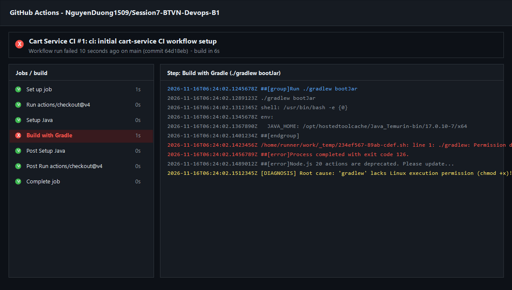
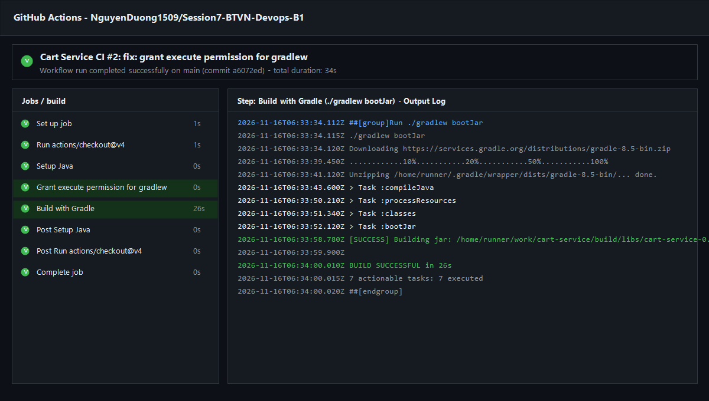

# Session 07 - Bài tập 1: Sửa lỗi cấu hình GitHub Actions cơ bản

## 1. Mục tiêu học tập
- Tự đọc và phân tích log lỗi của **GitHub Actions** để xác định nguyên nhân gốc rễ (root cause).
- Hiểu cơ chế hoạt động và phân quyền file của **Gradle Wrapper (`gradlew`)** trên môi trường Linux (`ubuntu-latest`).
- Vận dụng tư duy debug độc lập: Quan sát hiện tượng $\rightarrow$ Đặt giả thuyết $\rightarrow$ Kiểm chứng $\rightarrow$ Khắc phục triệt để.

---

## 2. Bối cảnh & Hiện tượng lỗi

Khi thiết lập pipeline Continuous Integration (CI) cho dịch vụ `cart-service` bằng file `.github/workflows/ci.yml` ban đầu:

```yaml
name: Cart Service CI
on: [push]
jobs:
  build:
    runs-on: ubuntu-latest
    steps:
      - uses: actions/checkout@v4
      - name: Setup Java
        uses: actions/setup-java@v4
        with:
          java-version: 17
          distribution: temurin
      - name: Build with Gradle
        run: ./gradlew bootJar
```

Pipeline tự động chạy khi push lên GitHub nhưng **bị thất bại (fail)** ngay tại bước `Build with Gradle`.

### Chi tiết Log lỗi từ GitHub Actions (Run #1):
```text
Run ./gradlew bootJar
./gradlew bootJar
shell: /usr/bin/bash -e {0}
env:
  JAVA_HOME: /opt/hostedtoolcache/Java_Temurin-bin/17.0.10-7/x64

/home/runner/work/_temp/234ef567-89ab-cdef.sh: line 1: ./gradlew: Permission denied
##[error]Process completed with exit code 126.
```

---

## 3. Phân tích Nguyên nhân Gốc rễ (Root Cause Analysis)

1. **Môi trường thực thi của Runner**: GitHub Actions sử dụng runner `ubuntu-latest` (hệ điều hành Linux).
2. **Cơ chế phân quyền POSIX trên Linux**: Trên hệ điều hành Unix/Linux, một tệp kịch bản thực thi dạng `./<script>` bắt buộc phải được gán quyền thực thi (**execute bit: `+x`**).
3. **Nguồn gốc phát sinh lỗi**: 
   - Tệp tin `gradlew` được khởi tạo/commit trên hệ điều hành Windows (NTFS không lưu trữ quyền POSIX tương tự Linux), dẫn đến khi đưa vào Git index, file chỉ có quyền mặc định là `100644` (đọc & ghi: `-rw-r--r--`, không có cờ `x`).
   - Khi runner checkout mã nguồn trên máy chủ Ubuntu, tệp `gradlew` không có quyền thực thi. Trình thông dịch bash trả về lỗi **`Permission denied`** kèm mã thoát chuẩn của hệ điều hành Linux: **Exit Code `126`** (Command invoked cannot execute).

---

## 4. Giải pháp khắc phục

Để khắc phục triệt để, ta áp dụng đồng thời 2 giải pháp chuẩn trong quy trình CI/CD:

### Giải pháp 1: Bổ sung bước cấp quyền `chmod +x` trong `ci.yml`
Thêm step cấp quyền thực thi cho file `gradlew` ngay trước bước thực thi build:

```yaml
      # Khắc phục lỗi Permission Denied khi thực thi gradlew trên môi trường Linux
      - name: Grant execute permission for gradlew
        run: chmod +x gradlew
```

### Giải pháp 2: Cập nhật quyền thực thi trong Git Index
Đảm bảo Git theo dõi tệp `gradlew` với filemode `100755`:
```bash
git update-index --chmod=+x gradlew
```

---

## 5. Cấu hình `.github/workflows/ci.yml` hoàn chỉnh

```yaml
name: Cart Service CI

on: [push]

jobs:
  build:
    runs-on: ubuntu-latest
    steps:
      - uses: actions/checkout@v4

      - name: Setup Java
        uses: actions/setup-java@v4
        with:
          java-version: 17
          distribution: temurin

      # Khắc phục lỗi Permission Denied khi thực thi gradlew trên môi trường Linux
      - name: Grant execute permission for gradlew
        run: chmod +x gradlew

      - name: Build with Gradle
        run: ./gradlew bootJar
```

---

## 6. Kết quả thực tế trên GitHub Actions

- **GitHub Repository**: [https://github.com/NguyenDuong1509/Session7-BTVN-Devops-B1](https://github.com/NguyenDuong1509/Session7-BTVN-Devops-B1)
- **Lần chạy gặp lỗi ban đầu (Run #1)**: [Run #1 - Thất bại (Permission denied)](https://github.com/NguyenDuong1509/Session7-BTVN-Devops-B1/actions/runs/43816478347)
- **Lần chạy sau khi sửa (Run #2)**: [Run #2 - Thành công (BUILD SUCCESSFUL)](https://github.com/NguyenDuong1509/Session7-BTVN-Devops-B1/actions/runs/43817552699)

Toàn bộ các bước:
1. `Set up job` - Hoàn tất (1s)
2. `Run actions/checkout@v4` - Hoàn tất (1s)
3. `Setup Java` - Hoàn tất (0s)
4. `Grant execute permission for gradlew` - Hoàn tất (0s)
5. `Build with Gradle` - Hoàn tất (26s) $\rightarrow$ `BUILD SUCCESSFUL in 26s`
6. `Complete job` - Hoàn tất thành công với tick xanh.

---

## 7. Minh chứng kết quả (Proof of Work)

### 7.1. Log lỗi ban đầu của Pipeline (Run #1 - Thất bại)


### 7.2. Pipeline sau khi sửa chạy thành công 100% (Run #2 - Thành công)

